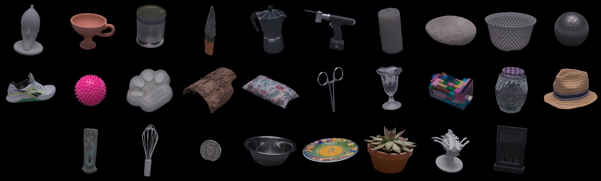

# Martine: Benchmarking Multi-View 3D Surface Reconstruction Across Viewpoint Coverage, Resolution, and Lighting

[](LICENSE)
[](LICENSE-CODE)
[](https://martine-benchmark.github.io/)
[](https://arxiv.org/abs/2611.11602)
[](https://doi.org/10.7910/DVN/2BEPEH)
[](https://www.python.org/)
[](https://github.com/martine-benchmark/martine-dataset/actions/workflows/tests.yml)

[**Robin Bruneau**](https://robinbruneau.github.io/)<sup>&#9733;</sup> · [**Baptiste Brument**](https://bbrument.github.io/)<sup>&#9733;</sup> ·
[**Frederic Giraud**](https://rocs.balgrist.ch/en/dr-frederic-giraud/) · [**Bastian Sigrist**](https://rocs.balgrist.ch/en/bastian-sigrist/) · [**Sascha Jecklin**](https://www.linkedin.com/in/saschajecklin/) · [**Philipp Fürnstahl**](https://rocs.balgrist.ch/en/prof-dr-philipp-fuernstahl/) · [**Bjoern Menze**](https://www.dqbm.uzh.ch/en/research/menze/team/team-bjoern-menze.html) · [**Lilian Calvet**](https://www.linkedin.com/in/lilian-calvet-42b1a689/) (<sup>&#9733;</sup> equal contribution)

**Martine** is a controlled, high-precision benchmark of 3D object surface reconstruction across viewpoint coverage,
image resolution and lighting, for multi-view stereo (MVS) and multi-view photometric stereo (MVPS) methods. This
repository downloads the data, documents its format and converts it to the inputs of the paper's methods.

## The dataset

- **28 objects** chosen for their optical and geometric challenges (transparency, specularity, low texture, fine
  structures, curvature); GT for 26 of them (`pillow` and `coin` ship images and cameras only).
- **84 views** on a spherical cap (20° to 70° elevation), from a robot arm and a turntable; a single light (**MVS**)
  and a dome of **30 LEDs** (**MVPS**), calibrated in one metric frame (mm).
- **Ground truth**: Artec Spider scanner (0.05 mm accuracy) or NAEOTOM Alpha CT scanner, with per-point property
  masks (lambertian, specular, transparent, textureless, fine structure) plus curvature and visibility.
- **Four resolution tiers**, exact pixel-area downsamplings, 16-bit EXR:

| Tier | Resolution | MVS (84 views) | MVPS (84 poses × 30 LEDs) |
| :-: | :-: | :-: | :-: |
| `d1` | 9568 × 6376 | 46 GB | n/a |
| `d2` | 4784 × 3188 | 12 GB | 427 GB |
| `d4` | 2392 × 1594 | 3 GB | 113 GB |
| `d8` | 1196 × 797 | 1 GB | 31 GB |

Totals over the 28 objects. Downloading the ground truth data (`gt/`) adds 19 GB to the total size. For storage
optimization purposes, areas beyond a defined safety margin in each image have been masked out. The original
unmasked EXR and RAW (`.ARW`) files remain available upon request.

<details><summary><b>Challenges per object</b></summary>

- **Lambertian**: `colander`, `hammer_head`, `knife`, `paw_pad`, `plant`, `rock`, `sneakers`, `spine`, `straw_hat`,
  `vase`, `warrior_head`, `wood`
- **Specular**: `bowl`, `can`, `grid`, `lego`, `moka_pot`, `petanque_ball`, `plate`, `spikes_ball`, `surgery_saw`,
  `surgery_scissors`, `whisk`
- **Transparent**: `glass`, `jam_pot`, `lego`, `paw_pad`
- **Textureless**: `bowl`, `candle`, `colander`, `surgery_saw`, `warrior_head`, `wood`
- **Fine structure**: `candle`, `grid`, `spikes_ball`, `surgery_saw`, `surgery_scissors`, `whisk`
- **GT by CT scan**: `bowl`, `grid`, `paw_pad`, `plant`, `spine`, `warrior_head` (+ Artec Spider); Artec Spider for the
  others; none for `coin`, `pillow`.

Each property is a mask `gt/challenges/<property>.npy` over the GT points; see
[docs/DATA_FORMAT.md](docs/DATA_FORMAT.md).
</details>

## Download

The data is on Harvard Dataverse ([doi:10.7910/DVN/2BEPEH](https://doi.org/10.7910/DVN/2BEPEH)) as TAR archives.
`scripts/download_data.py` needs Python 3.10+ only (standard library): it downloads, checks (MD5) and extracts the
archives, and resumes an interrupted run. Example: one object at d4 (the common base of the paper's evaluations)
with its ground truth, about 0.7 GB:

```bash
git clone https://github.com/martine-benchmark/martine-dataset.git && cd martine-dataset
python scripts/download_data.py --objects rock --mvs --groundtruth --tiers d4 --dry-run   # list and size
python scripts/download_data.py --objects rock --mvs --groundtruth --tiers d4            # into martine_dataset/
```

| Option | Selects |
| :-- | :-- |
| `--mvs`, `--mvps`, `--groundtruth`, `--calibration` | modalities (combinable; none = all) |
| `--tiers d8 [d4 ...]` | resolution tiers, required with MVS or MVPS images (MVPS has no d1) |
| `--objects rock vase` | a subset of objects (default: all 28) |
| `--out DIR`, `--dry-run`, `--keep-archives` | destination; list and size only; keep the TARs |
| `--verify` | re-check the MD5 of every extracted file, download again the corrupted archives |

## Data format

```text
martine_dataset/
├── <object>/
│   ├── mvs/<tier>/       images/NNN.exr, masks/NNN.png, sfm.json
│   ├── mvps/<tier>/      images/pose_KK/lighting_LL.exr, dark/pose_KK.exr, masks/, sfm.json
│   └── gt/               gt.ply, evaluation points, challenge masks
└── calibration/
    ├── lights/           per-LED models (isotropic, anisotropic)
    ├── spheres/          lambertian/, specular/: d1 images, dark/, masks/, sfm.json, sphere.json
    └── color_checker/    mvs.png, mvps.png
```

The cameras are AliceVision `sfm.json` files (pinhole, undistorted images, centre of the top-left pixel at (0, 0),
mm). **The GT mesh is in the `sfm.json` frame up to `diag(1, −1, −1)`.** File naming, acquisition order and camera
conventions: [docs/DATA_FORMAT.md](docs/DATA_FORMAT.md).

## Run a method

`martine-convert` writes the inputs of each method of the paper in its own pixel convention: the method then runs
with its own code. Install it with [uv](https://docs.astral.sh/uv/) (or `pip install -e ".[tri]"`), then convert
the rock downloaded above for COLMAP:

```bash
uv sync --extra tri        # tri: pycolmap, for the sparse points of COLMAP-based methods
uv run martine-convert mvs --data martine_dataset --object rock --tier d4 --format colmap-mvs --out work/rock_colmap
```

Formats: COLMAP, PGSR, Meshroom, RealityScan, NeuS2, Neuralangelo (MVS); Uni-MS-PS, SDM-UniPS, LINO-UniPS (PS);
RNb-NeuS2, SuperNormal (MVPS). Commands, versions and conventions: [converters/README.md](converters/README.md).

## Evaluate

[eval-3d](https://github.com/martine-benchmark/eval-3d) scores a mesh against the GT (Chamfer distance, F-score,
per-property scores), as in the paper: [docs/EVALUATION.md](docs/EVALUATION.md).

## Calibration

- **Cameras**: structure from motion on the textured turntable fabric, independent of the object; 0.54 px mean
  reprojection error (about 0.04 mm) on held-out checkerboards.
- **Image-to-GT alignment**: contour ICP; 1.22 px mean leave-one-out residual at d1, below 2 px for all 26 objects.
- **Lights**: `calibration/lights/` (per-LED position, axis, intensity; isotropic and anisotropic models); PS
  normals on the calibration spheres within 0.63° of the true ones.
- **Calibration spheres**: `calibration/spheres/{lambertian,specular}/`, the captures behind the light calibration,
  at d1: 20 turntable views x 30 LEDs, LEDs-off frames, sphere masks, cameras (`sfm.json`) and the fitted sphere
  (`sphere.json`).
- **ColorChecker**: `calibration/color_checker/`, the chart under the MVS lighting (`mvs.png`) and under the MVPS
  lighting (`mvps.png`), developed 8-bit sRGB images.

## Related projects

| Repository | Role |
| :-- | :-- |
| [eval-3d](https://github.com/martine-benchmark/eval-3d) | Mesh-vs-ground-truth evaluation (Chamfer, F-score, per-property analysis) |
| [contour-registration](https://github.com/martine-benchmark/contour-registration) | Mesh-to-image alignment by multi-view contour ICP |

## License

The data (images, masks, cameras, ground truth, calibration) and the documentation are under
[CC BY 4.0](LICENSE); the code (`scripts/`, `converters/`) is under the [MIT License](LICENSE-CODE).
Copyright (c) 2026 Baptiste Brument and the Martine authors.

## Citation

```bibtex
@inproceedings{martine2026,
  title={Martine: Benchmarking Multi-View 3D Surface Reconstruction Across Viewpoint Coverage, Resolution, and Lighting},
  author={Bruneau, Robin and Brument, Baptiste and Giraud, Frederic and Sigrist, Bastian and Jecklin, Sascha and Fürnstahl, Philipp and Menze, Bjoern and Calvet, Lilian},
  booktitle={NeurIPS Evaluations \& Datasets (E\&D) Track},
  year={2026}
}
```
