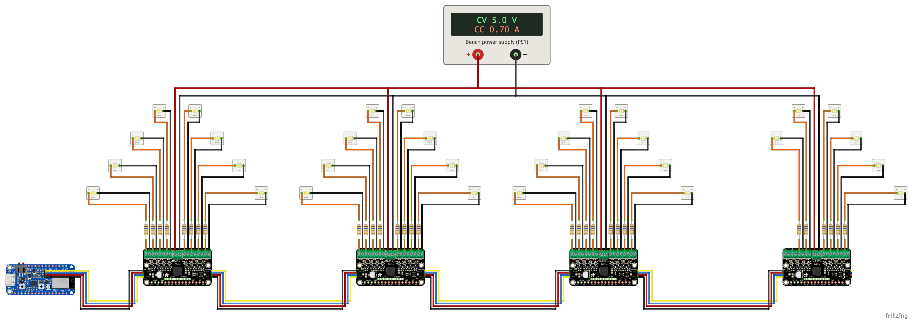

# MARTINE light dome

Everything needed to rebuild the LED dome used for the **multi-light**
acquisition regime of the MARTINE dataset: the 3D-printable structure, the
electronics and the wiring.

The dome is a spherical-cap rig, **85 cm in diameter**, holding **30 Luxeon
Rebel LEDs** (220 lm each). It is rigidly mounted to the camera, so the
camera–LED configuration is the same for every viewpoint. The LEDs are switched
on **one at a time** (one-light-at-a-time protocol) by an ESP32 controlled from
a PC. See Section 2.2 of the paper for the full acquisition setup.

## What is provided

| Path | Content |
|---|---|
| [3d-printable-dome/](3d-printable-dome/) | Parts of the dome structure: `.stl` (for printing) and, for most parts, `.stp` (CAD source, for modification) |
| [3d-printable-dome/full_Dome.stl](3d-printable-dome/full_Dome.stl) | Full assembled dome, **reference only** (do not print) |
| [led-controller/esp32_to_driver.ino](led-controller/esp32_to_driver.ino) | ESP32 firmware (Arduino sketch) |

## 1. 3D-printed structure

### Material and finish

- Printed in **nylon**, chosen because it is **stronger** than standard
  filaments (PLA, PETG): the dome is large, carries 30 LEDs and their wiring,
  and is mounted on a moving robotic arm.
- **Painted black** after printing, to limit stray reflections of the LED
  light onto the object.

### Parts to print

| File | Approx. size (mm) | Quantity |
|---|---|---|
| `Part_1.stl` | 144 × 109 × 213 | 10 |
| `Part_2.stl` | 124 × 131 × 234 | 10 |
| `Stabilizer.stl` | 52 × 18 × 120 | 6 |
| `Stabilizer_to_Part_A.stl` | 106 × 41 × 82 | 4 |
| `Part_A_sup_L.stl` | 41 × 134 × 114 | 1 |
| `Part_A_sup_R.stl` | 41 × 134 × 114 | 1 |
| `Part_A_inf_L.stl` | 89 × 126 × 46 | 1 |
| `Part_A_inf_R.stl` | 89 × 126 × 46 | 1 |
| `LED-adapter.stl` | 28 × 10 × 28 | 30 (one per LED) |
| `Connector_big.stl` | 24 × 24 × 33 | 20 |
| `Connector_small.stl` | 24 × 24 × 22 | 20 |

The four Part A pieces (upper/lower, left/right) are each printed once.
Use `full_Dome.stl` to see how the parts fit together.

## 2. Electronics

### How it works

- A **PC** sends commands over USB-C to an **ESP32 Feather V2** (U1).
- The ESP32 drives **four 8-channel I2C drivers** (U2–U5, one MCP23017 +
  8 MOSFETs each), daisy-chained with STEMMA QT cables.
- Each LED channel is wired as: driver `+` → 1.6 Ω resistor → LED → driver
  output (low-side switching). 30 of the 32 available outputs are used.
- A **bench power supply** (PS1) in **constant-current mode (700 mA, CV 5 V)**
  powers the LEDs and sets the current of the LED that is on.
- **Only one LED is on at a time**, for 2 s at most.

Sequence for one image:

1. The PC sends U1 the command "turn on LED n".
2. U1 works out the driver and output concerned, then writes port A of that
   MCP23017: output k goes high, every other output, on every board, is low.
3. MOSFET k conducts and connects the cathode of LED n to ground: the LED
   lights up.
4. PS1, in current-limit mode, adjusts its voltage so that 700 mA flows
   through the LED.
5. After the capture, U1 turns the output off and moves on to the next LED.

The drivers only switch (no PWM, no current regulation): the current is set
by PS1, not by the resistors. This only works because only one LED is on at a
time.

### Components

| Reference | Component | Characteristics | Qty | Documentation |
|---|---|---|---|---|
| U1 | Adafruit **5400**, ESP32 Feather V2, 8 MB flash + 2 MB PSRAM, STEMMA QT | ESP32 Pico, 3.3 V logic, USB-C | 1 | [product](https://www.adafruit.com/product/5400) · [guide](https://learn.adafruit.com/adafruit-esp32-feather-v2) |
| U2–U5 | Adafruit **6318**, I2C to 8 Channel Solenoid Driver | MCP23017 + 8 × AO3406 MOSFET (30 V, 3.6 A peak, 70 mΩ), V+ 3 to 24 V, 3 V or 5 V logic | 4 | [product](https://www.adafruit.com/product/6318) · [guide](https://learn.adafruit.com/adafruit-i2c-to-8-channel-solenoid-driver) |
| LED1–LED30 | Luxeon Star **SR-05-WN120** (LED LXML-PWN1-0120, Luxeon Rebel) | Neutral white 4100 K, CRI 65, 120°, Vf 3 V typ. / 3.99 V max, 220 lm at 700 mA, 1000 mA max | 30 | [product](https://luxeonstar.com/product/sr-05-wn120/) · [LED datasheet](https://luxeonstar.com/wp-content/uploads/documentation/ds64.pdf) · [module datasheet](https://luxeonstar.com/wp-content/uploads/documentation/sr-05.pdf) |
| R1–R30 | Series resistor, one per LED | **1.6 Ω**, at least 1 W (2 W recommended) | 30 | — |
| PS1 | Bench power supply | Constant-current (CC) mode required; set to CC 700 mA, CV 5 V | 1 | — |
| W1–W4 | STEMMA QT / Qwiic cable (4-pin JST SH) | I2C + 3.3 V + GND | 4 | — |
| — | USB-C cable | PC ↔ U1, data + power | 1 | — |
| — | Hook-up wire | LEDs and power, must carry 0.7 A | — | — |

### Wiring

*Wiring diagram (click for the PDF version). All 32 outputs are drawn; only
30 are used in the dome.*

1. **PC ↔ ESP32.** Connect U1 to the PC with the USB-C cable. The same cable
   powers U1 and carries the commands.
2. **I2C bus.** Chain U1 → U2 → U3 → U4 → U5 with the STEMMA QT cables
   W1–W4. On U1, SDA = GPIO 22 and SCL = GPIO 20. The cable also brings 3.3 V
   to the MCP23017 logic and connects the grounds.
3. **I2C addresses.** Each driver must have a **different address**:
   0x20 + A0 (1) + A1 (2) + A2 (4), where each soldered jumper adds its value.

   | Driver | A2 | A1 | A0 | Address |
   |---|---|---|---|---|
   | U2 | open | open | open | 0x20 |
   | U3 | open | open | **closed** | 0x21 |
   | U4 | open | **closed** | open | 0x22 |
   | U5 | open | **closed** | **closed** | 0x23 |

4. **Power.** Connect PS1 `+` to the V+ terminal and PS1 `−` to the GND
   terminal of each of the four drivers.
5. **LED channels (×30, all identical).**

   | From | To |
   |---|---|
   | Channel `+` terminal of the driver | Resistor Rn, side 1 |
   | Resistor Rn, side 2 | LED n anode (`+`) |
   | LED n cathode (`−`) | Output terminal k of the driver (0–7) |

   The MOSFET, its gate drive and the flyback diode are on the driver board;
   nothing else to wire. Any LED can go on any output: just record which LED
   is on which output for the firmware.
6. **Settings.** Set PS1 to **CC 700 mA, CV 5 V** before switching on.

## 3. Firmware

The ESP32 sketch is
[led-controller/esp32_to_driver.ino](led-controller/esp32_to_driver.ino).

**Upload.**

1. Install the Arduino IDE, the **ESP32 board package** (Espressif) and the
   **Adafruit MCP23017** library (Library Manager).
2. Select the board **Adafruit Feather ESP32 V2**, plug U1 over USB-C and
   upload the sketch.

The STEMMA QT power (GPIO 2) is enabled automatically by the Arduino board
package. The sketch expects the four drivers at addresses **0x20, 0x21, 0x22,
0x23** (edit `addresses[]` otherwise) and stops at start-up if one is missing.

**Serial protocol** (USB serial, **115200 baud**, one command per line ending
with `\n`):

| Command | Effect | Reply |
|---|---|---|
| `0` … `31` | **Toggles** output n: board n / 8 (in `addresses[]` order), output n % 8 | `done` |
| `-1` | Turns every output off | `Turning all solenoids OFF.` then `done` |
| anything else | Nothing | error message |

Since a command toggles the output, a capture of LED n is: send `n` (on),
wait for `done`, take the image, send `n` again (off). The firmware does not
turn the previous LED off by itself: **the PC script must switch each LED off
before switching the next one on**, so that only one LED is ever on. Send
`-1` at the start of a sequence to start from a known state.

## ⚠️ Precautions

- **Only one LED on at a time.** Several LEDs on together would share the
  700 mA unevenly and the lighting would be wrong.
- **No heatsink.** Each LED dissipates about 2 W; keep on-times short (2 s at
  most in the prototype). For longer on-times, the manufacturer recommends a
  heatsink.
- **Glare.** 220 lm from a point source: do not look straight into a lit LED.
